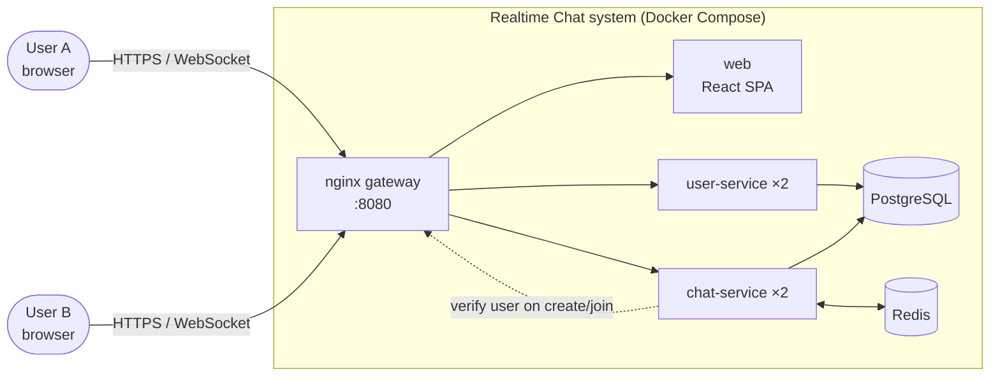
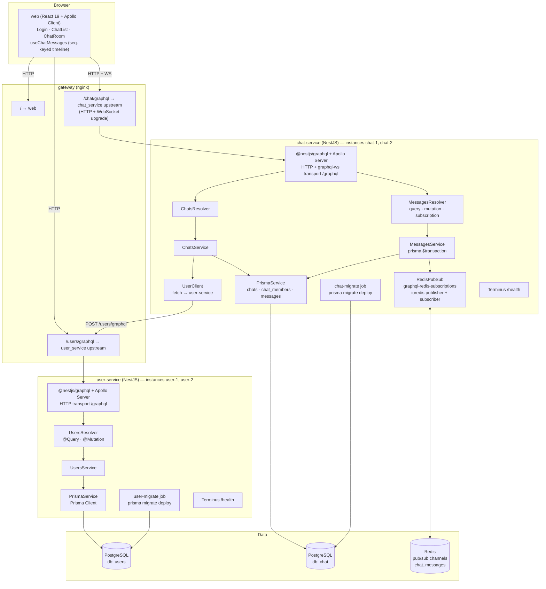
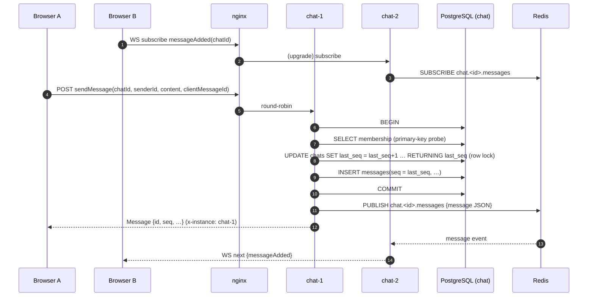
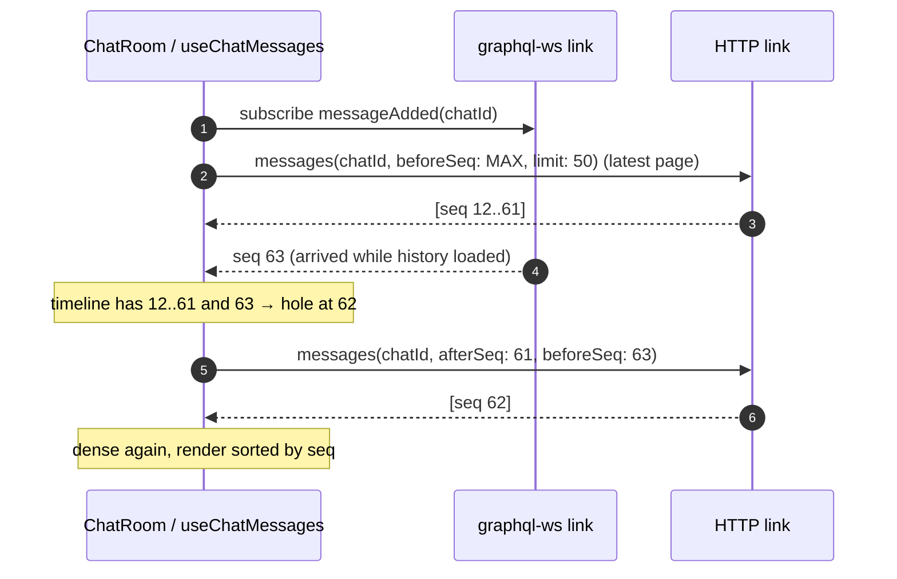
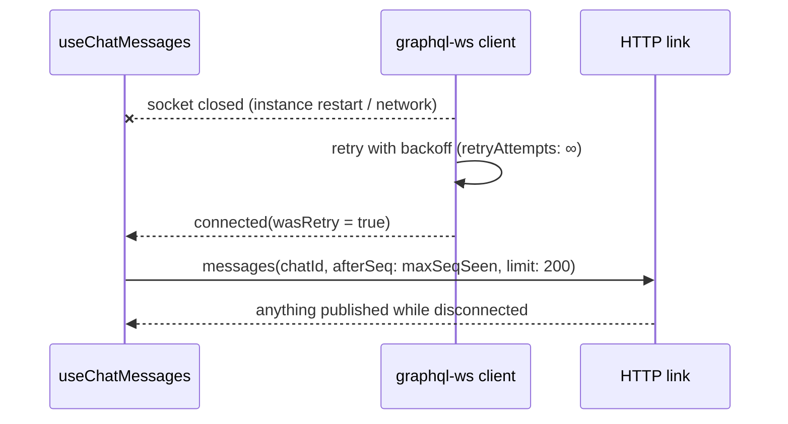
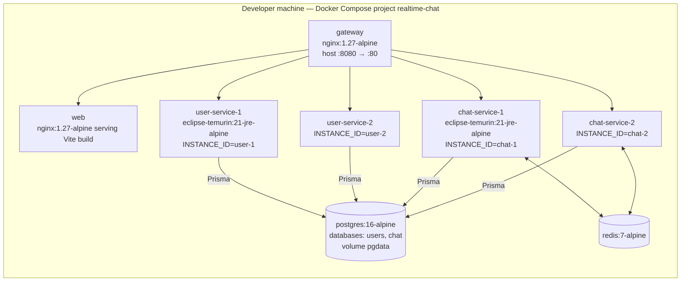

# High-Level Design: Scalable Real-Time Chat

| | |
|---|---|
| Status | Implemented and verified (unit, schema, integration, e2e) |
| Companion docs | [LLD.md](LLD.md) (package and data design), [IMPLEMENTATION_PLAN.md](IMPLEMENTATION_PLAN.md) (decision log), [../README.md](../README.md) (how to run) |
| Diagrams | Mermaid; render on GitHub or in any Mermaid-aware viewer |

## 1. Purpose and scope

A chat system where users create and join chats, send messages, and see new messages live.
Two backend services and one frontend, every backend running as two or more instances behind a
load balancer, started locally with one `docker compose up`.

In scope: users, chats, membership, ordered message history, real-time delivery that is correct
across instances. Out of scope: authentication, presence, typing indicators, attachments, message
editing, and scaling the data tier itself.

The backends are written in TypeScript with NestJS 11 (code-first GraphQL on Apollo Server 5,
Prisma 6). Nothing in this design depends on the backend framework: the ordering, fan-out and
delivery guarantees are properties of PostgreSQL, Redis and the GraphQL contract.

## 2. Requirements

### Functional

| ID | Requirement |
|---|---|
| F1 | Create a user; look a user up by id, by username, or in batch |
| F2 | Create a chat; join a chat; list chats |
| F3 | Send a message to a chat you are a member of |
| F4 | Read chat history in order, with paging |
| F5 | Receive new messages in a chat live, without refreshing |

### Non-functional

| ID | Requirement | How it is met |
|---|---|---|
| N1 | Messages appear in the same order for everyone | Server-assigned per-chat sequence number (see section 5.1) |
| N2 | Correct with two or more instances of each service | No instance-local state; Redis pub/sub for fan-out; DB-assigned ordering |
| N3 | No lost messages across WebSocket drops or instance restarts | Persist before publish; client catch-up by sequence number |
| N4 | One-command local start | Docker Compose with health-gated startup; one-shot `prisma migrate deploy` jobs run before any instance starts |
| N5 | Observable | `x-instance` header on every response; instance id in every log line; `/health` per service |

## 3. System context

## 4. Component diagram

**Responsibilities**

| Component | Owns | Talks to |
|---|---|---|
| web | UI state, session (localStorage), seq-keyed message timeline, optimistic sends | gateway only |
| gateway | Single origin, round-robin across instances, WebSocket upgrade, health routing | web, user-service, chat-service |
| user-service | `users` table; username uniqueness and normalisation | its own database |
| chat-service | `chats`, `chat_members`, `messages`; sequence assignment; live fan-out | its own database, Redis, user-service (create/join only) |
| PostgreSQL | Durable state; the ordering authority (row lock on `chats.last_seq`) | — |
| Redis | Transient fan-out between chat-service instances | — |

## 5. Key design decisions

### 5.1 Ordering: a per-chat sequence number assigned by the database

Every chat row has `last_seq`. Sending a message is one transaction that increments it with a
row lock and inserts the message with the returned value. Concurrent senders to the same chat,
from any instance, are serialised on that row, so `seq` is strictly increasing and gap-free per
chat. A unique index on `(chat_id, seq)` makes a duplicate position impossible.

Rejected: timestamps (instance clocks are not comparable at millisecond resolution), client-side
ids (clients cannot agree on a global order), a global sequence (needless contention across chats).

### 5.2 Fan-out: Redis Pub/Sub between instances

After commit, the handling instance publishes the message to the channel for that chat. Every
instance subscribes to the channels its own WebSocket clients watch and forwards the event. A
client on chat-2 therefore sees what chat-1 persisted, without sticky sessions.

Rejected: Postgres `LISTEN/NOTIFY` (8 KB payload limit, one listening connection per instance,
not production-typical), Kafka (far heavier than the problem), sticky sessions (does not solve
cross-instance delivery at all).

### 5.3 Delivery guarantee: persist first, publish second, catch up by seq

Redis Pub/Sub is at-most-once in transit. That is acceptable because the message is already in
PostgreSQL before publish, and the client can always recover: it keys messages by `seq`, fetches
any hole it detects inside its loaded range, and after a reconnect fetches everything after the
highest `seq` it has. Nothing is lost or reordered; at worst delivery is briefly delayed.

### 5.4 Service boundaries

Each service owns one database. chat-service stores only `senderId` and never calls user-service
on the hot path; it verifies a user exists once, when a chat is created or joined, and fails
closed if user-service is unreachable. The frontend resolves display names with one batched
`users(ids)` query.

### 5.5 Gateway and instances

nginx gives the browser one origin (no CORS), round-robins over two explicit named instances of
each service, and upgrades `/chat/graphql` to WebSocket. Apollo serves HTTP and the `graphql-ws`
subscription transport on the same `/graphql` path, so one nginx location handles both.
Service-to-service calls go through the same gateway so they are balanced too. Schema migrations
run once, in one-shot `user-migrate` / `chat-migrate` Compose jobs that the app instances wait
on, so two instances booting together never race on schema changes.

## 6. Primary flows

### 6.1 Send a message, deliver across instances

### 6.2 Open a chat room (history + live, gap-safe)

### 6.3 Reconnect

## 7. Deployment view

Startup ordering is enforced by Compose health checks: Postgres and Redis healthy →
`user-migrate` / `chat-migrate` run `prisma migrate deploy` and exit 0 → app instances boot and
become healthy (`/health` pings the database) → gateway starts.

Images are multi-stage `node:20-alpine` builds with the repository root as context: a cached
`pnpm install --frozen-lockfile --filter <service>` layer, then `prisma generate` + `nest build`,
then `pnpm deploy --prod` produces a self-contained folder with only production dependencies,
copied into a slim runtime stage that runs as the unprivileged `node` user. The migrate jobs
reuse the same image with a different command. The test overlay (`docker-compose.test.yml`)
additionally publishes each backend instance on its own host port so the e2e suite can target a
specific instance.

## 8. Scalability

- **Backends are stateless.** Any number of chat-service or user-service instances can be added
by appending to the nginx upstream and Compose file; nothing else changes. The only in-memory
state is the registry of live subscriptions on each instance, which is per-connection by nature.
- **Write contention is per chat.** The row lock on `chats.last_seq` serialises writers to one
chat only; chats never block each other. Human-speed chat is far below the lock's throughput.
- **Fan-out cost is per instance per chat.** Each instance subscribes to a chat's Redis channel
once, when its first local subscriber appears, and unsubscribes when the last one leaves. Redis
Pub/Sub handles hundreds of thousands of messages per second.
- **Data tier is the single-node limit** of this demo. The next steps would be read replicas for
history, Redis Cluster or a durable stream for fan-out, and partitioning chats by id.

## 9. Reliability and failure modes

| Failure | Effect | Recovery |
|---|---|---|
| One chat-service instance dies | Its WebSocket clients drop; nginx marks the upstream failed | Clients reconnect to the other instance and catch up by `seq`; nginx retries the other upstream |
| Redis unavailable | Sends still succeed (persisted); live delivery pauses | ioredis reconnects and re-subscribes; clients see the gap on next event or reconnect and backfill |
| PostgreSQL unavailable | Sends and reads fail with errors; `/health` goes red; nginx stops routing to unhealthy instances | Prisma reconnects on the next query; nothing was acknowledged that was not committed |
| user-service unavailable | Creating or joining a chat fails with `UPSTREAM_UNAVAILABLE`; chatting is unaffected | Retry the create/join |
| Client retries a send | Same `clientMessageId` → server returns the original message, no duplicate, no burned `seq` | Automatic |
| Duplicate delivery (history + live) | Collapses in the client's `seq`-keyed map | Automatic |
| Two instances boot at once on a fresh database | Neither migrates | Migrations ran once in the `*-migrate` job before either instance started |

## 10. Security posture (demo scope)

- No authentication: `userId` is client-supplied and trusted. Production would issue a JWT from
user-service, verify it at the gateway, and derive the sender from the token.
- Input validation in the service layer on every GraphQL input (lengths, UUIDs, character sets);
invalid UUIDs are rejected with `BAD_USER_INPUT` before reaching SQL.
- All SQL goes through Prisma (parameterised); the one raw statement (`UPDATE … RETURNING
last_seq`) uses Prisma's tagged-template `$queryRaw`, which binds parameters.
- Domain errors are `GraphQLError` subclasses with a stable `extensions.code` (`NOT_FOUND`,
`CONFLICT`, `FORBIDDEN`, …); stack traces are excluded from responses when `NODE_ENV=production`.
- Containers run as the unprivileged `node` user; only the gateway publishes a host port in the
default Compose file.

## 11. Observability

- `x-instance` response header on every HTTP response, set by a global Nest interceptor.
- Every log line is prefixed with the instance id; message persistence, publication, idempotent
replays and subscription attachment are logged with chat id and `seq`.
- `/health` per service (`@nestjs/terminus`) pings the database and gates Compose startup.
- Apollo Sandbox at `/graphql` on every instance (via the gateway: `/users/graphql`, `/chat/graphql`).
- `scripts/demo-cross-instance.sh` tails both chat instances to show cross-instance delivery live.

## 12. Technology summary

| Layer | Choice |
|---|---|
| Language | TypeScript everywhere (services, web app, e2e suites) |
| Backend framework | NestJS 11, `@nestjs/graphql` code-first on Apollo Server 5, `graphql-ws` subscriptions |
| Data access | Prisma 6 with explicit SQL migrations, PostgreSQL 16 |
| Fan-out | Redis 7 Pub/Sub via `graphql-redis-subscriptions` (ioredis) |
| Frontend | React 19, Vite, Apollo Client 3 (split HTTP/WS link) |
| Edge | nginx 1.27 |
| Packaging | pnpm 9 workspaces, multi-stage `node:20-alpine` Dockerfiles with `pnpm deploy`, Docker Compose v2 |
| Tests | Jest (unit + integration), Testcontainers, supertest, Vitest, Playwright |
