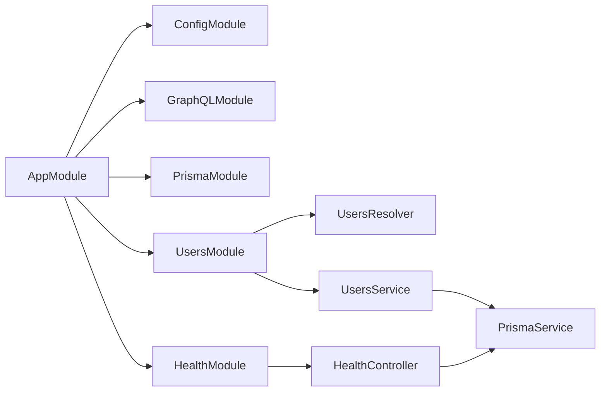
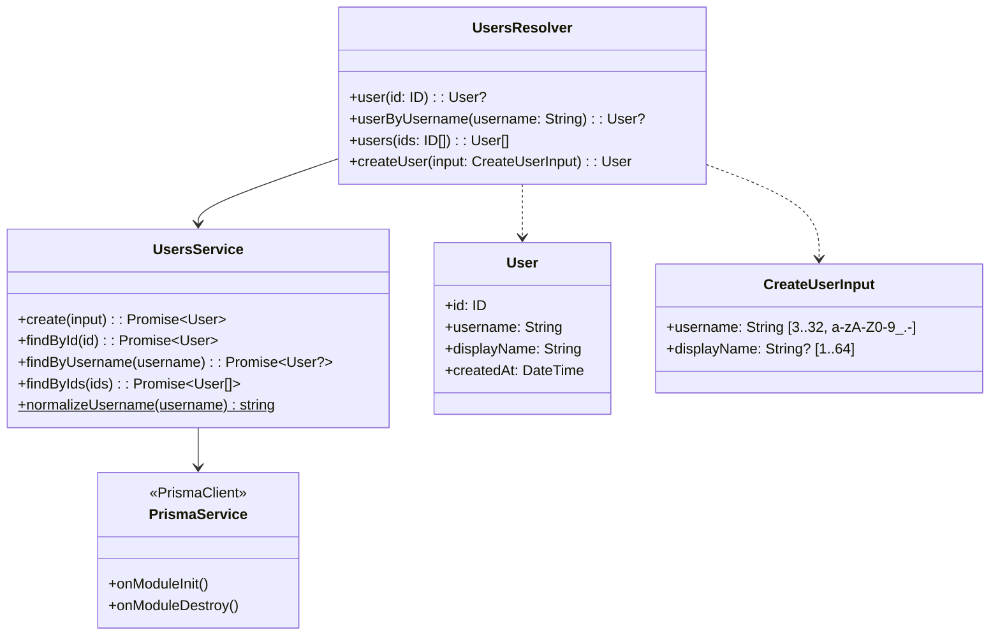
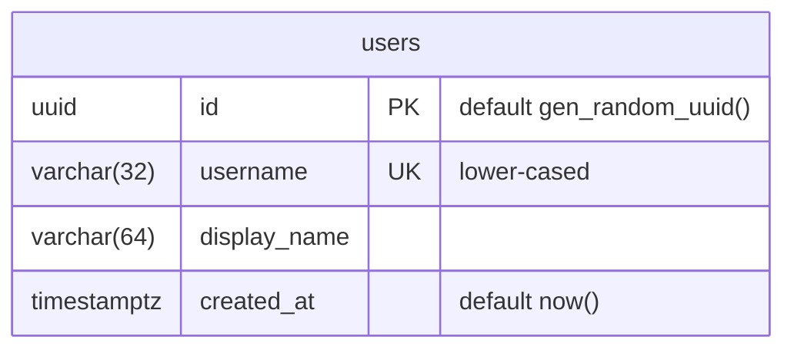
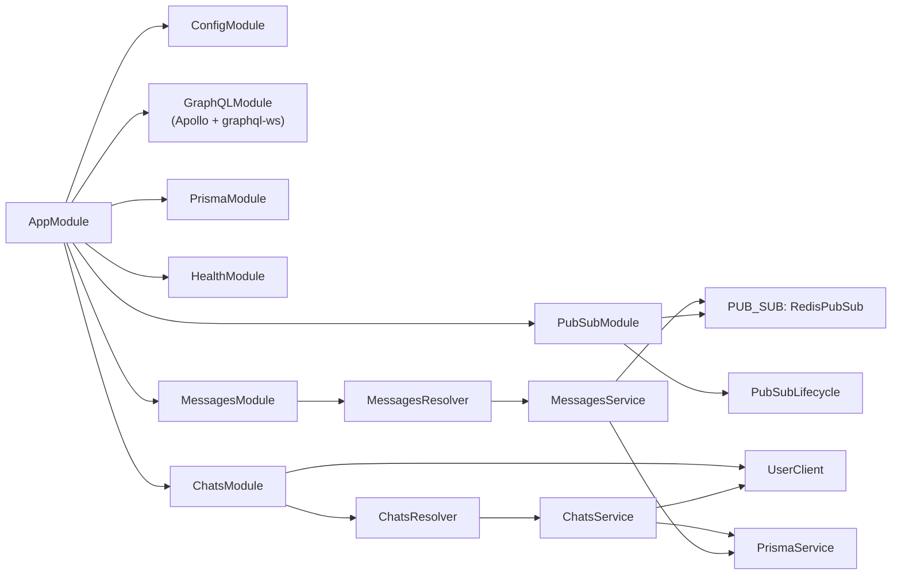
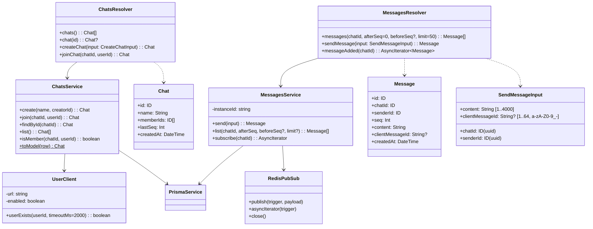
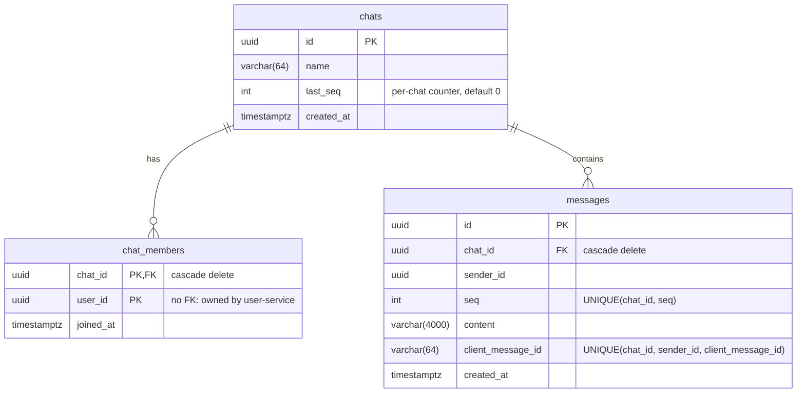
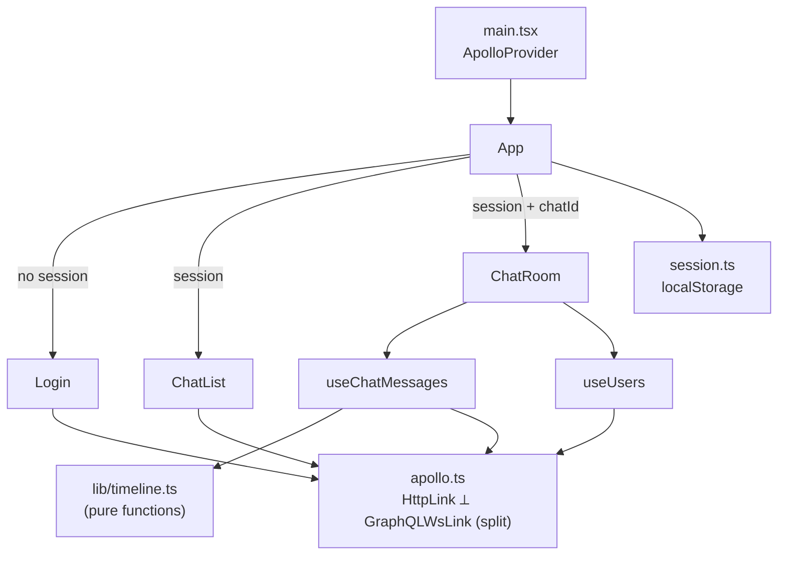
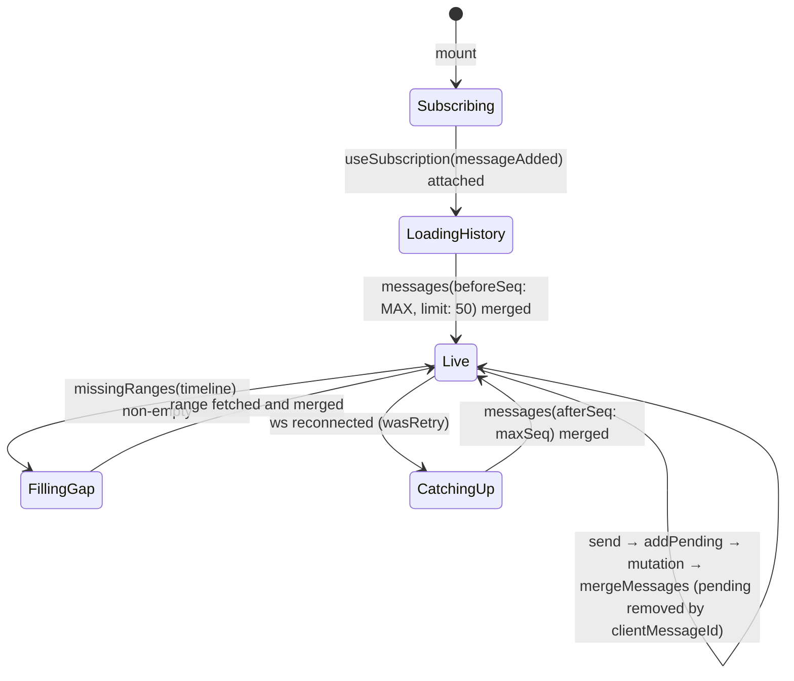
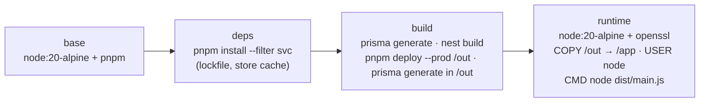

# Low-Level Design: Scalable Real-Time Chat

Companion to [HLD.md](HLD.md). This document describes how each component is built: modules,
classes, data model, API contracts, algorithms, error handling, configuration and build.
Paths are relative to the repository root.

## 1. Repository layout

```
apps/user-service/      NestJS app, Prisma schema + migrations (db: users)
apps/chat-service/      NestJS app, Prisma schema + migrations (db: chat), Redis pub/sub
apps/web/               React SPA (Vite)
e2e/                    Jest API e2e (cross-instance) + Playwright UI e2e
infra/nginx/            gateway.conf
infra/postgres/         init.sql (creates both databases)
docker-compose.yml      full stack; docker-compose.test.yml exposes each instance
docs/                   this document, HLD, implementation plan
```

Tooling: pnpm 9 workspaces (`apps/*`, `e2e`), TypeScript 5.9, shared `tsconfig.base.json`
(ES2022, CommonJS for Nest, decorators enabled). The web app has its own bundler-mode tsconfig.

## 2. user-service

### 2.1 Module graph



`PrismaModule` is `@Global()`, so `PrismaService` is injectable everywhere without re-import.
`ConfigModule.forRoot` is global and validates the environment with Joi at boot (section 8).

### 2.2 Classes



### 2.3 Behaviour

- `normalizeUsername` trims and lower-cases, so `Alice` and `alice` are the same account.
  `displayName` defaults to the username as typed.
- `create` relies on the database unique index, not a check-then-insert: a Prisma `P2002` error is
  mapped to `ConflictError` (`extensions.code = CONFLICT`). Two instances creating the same
  username concurrently cannot both succeed.
- `user(id)` returns `null` for unknown ids (query semantics); `findById` throws `NotFoundError`
  internally and the resolver converts it.
- `users(ids)` dedupes and caps at 200 ids and short-circuits on an empty list; it is the batch
  lookup the frontend uses to resolve sender names.
- `ParseUUIDPipe` on `user(id)` rejects malformed ids before they reach SQL.

### 2.4 Data model



Migration: `apps/user-service/prisma/migrations/20261101000000_init/migration.sql`.

## 3. chat-service

### 3.1 Module graph



`PubSubModule` is `@Global()` and provides the `PUB_SUB` token (a `RedisPubSub` with separate
publisher and subscriber ioredis connections). `PubSubLifecycle` closes both on shutdown so
instances and test processes exit cleanly.

### 3.2 Classes



### 3.3 Data model



Indexes and why they exist:

| Index | Purpose |
|---|---|
| `messages (chat_id, seq)` UNIQUE | Ordering + paging in one index scan; makes a duplicate position impossible |
| `messages (chat_id, sender_id, client_message_id)` UNIQUE | Idempotent retries; NULL `client_message_id` rows never collide (Postgres unique semantics) |
| `chat_members (user_id)` | "Chats I belong to" lookups |
| `chat_members` PK `(chat_id, user_id)` | Membership check is a primary-key probe |

### 3.4 Algorithm: `MessagesService.send`

```
input: chatId, senderId, content, clientMessageId?
1. content := trim(content)
2. tx := BEGIN
   a. member := SELECT 1 FROM chat_members WHERE chat_id=? AND user_id=?
      if none: chat exists ? throw FORBIDDEN : throw NOT_FOUND
   b. seq := UPDATE chats SET last_seq = last_seq + 1 WHERE id=? RETURNING last_seq
      -- takes a row lock; concurrent senders to this chat queue here, on any instance
   c. row := INSERT INTO messages (chat_id, sender_id, seq, content, client_message_id)
   COMMIT
3. PUBLISH chat.<chatId>.messages  { messageAdded: row }      -- after commit, never before
4. return row

on unique violation of (chat_id, sender_id, client_message_id):
   -- the whole tx rolled back, so the seq increment was undone (no gap)
   return SELECT the existing row with that clientMessageId   -- no re-publish
```

Properties: strictly increasing and gap-free `seq` per chat across instances; a message is never
published unless committed; a retried send is a no-op that returns the original message.

### 3.5 Algorithm: `MessagesService.list` (paging)

```
limit := clamp(limit, 1, 200), default 50
if beforeSeq given:  WHERE chat_id=? AND seq > afterSeq AND seq < beforeSeq
                     ORDER BY seq DESC LIMIT limit   → reverse → ascending page ending before beforeSeq
else:                WHERE chat_id=? AND seq > afterSeq
                     ORDER BY seq ASC LIMIT limit    → catch-up page after a cursor
```

Clients use `beforeSeq: 2147483647` for "latest page", `beforeSeq: minSeqLoaded` for "load
older", and `afterSeq: maxSeqSeen` for catch-up. The range form (both bounds) fills a detected
gap exactly.

### 3.6 Subscription path

```
Subscription.messageAdded(chatId)
  → assertUuid(chatId)
  → pubSub.asyncIterator("chat.<chatId>.messages")
      RedisPubSub SUBSCRIBEs the channel on first iterator for that trigger (per instance),
      UNSUBSCRIBEs when the last iterator for it is returned.
  → Apollo pushes each payload down the graphql-ws connection as { data: { messageAdded } }
```

Payloads travel through Redis as JSON; a `reviver` restores `createdAt` to a `Date` so the
`DateTime` scalar serialises it consistently.

### 3.7 `ChatsService.join`

```
1. chat exists? else NOT_FOUND
2. UserClient.userExists(userId)          -- POST { user(id) { id } } to USER_SERVICE_URL, 2 s timeout
   false → NOT_FOUND;  transport error → UPSTREAM_UNAVAILABLE (fail closed)
   (VERIFY_USERS=false disables the call; used by integration tests)
3. UPSERT chat_members (chat_id, user_id)  -- idempotent
4. return chat with memberIds
```

`create(name, creatorId)` verifies the creator the same way and inserts the chat and its first
member in one nested create.

## 4. web (React)

### 4.1 Structure



### 4.2 Apollo client (`apollo.ts`)

- `HttpLink.uri` is a function: `context.service === 'users'` → `/users/graphql`, else `/chat/graphql`.
- `split(isSubscription, GraphQLWsLink, HttpLink)`.
- graphql-ws client: `retryAttempts: Infinity`, `keepAlive: 10 s`; `on.connected(wasRetry)` fans
  out to `onReconnect` listeners so hooks can catch up.

### 4.3 Timeline model (`lib/timeline.ts`)

```ts
interface Timeline {
  bySeq: Map<number, Message>;   // the only source of truth for confirmed messages
  minSeq: number;                // 0 when empty
  maxSeq: number;                // 0 when empty
  pending: PendingMessage[];     // optimistic sends keyed by clientMessageId
}
mergeMessages(state, incoming[])   // upsert by seq, update bounds, drop pending that got confirmed
orderedMessages(state)             // values sorted by seq
missingRanges(state)               // holes strictly inside [minSeq, maxSeq] as {afterSeq, beforeSeq}
addPending / markPendingFailed / removePending
```

All functions are pure and unit-tested (`timeline.test.ts`).

### 4.4 `useChatMessages(chatId)` lifecycle



Guards: an in-flight set keyed by `(afterSeq, beforeSeq, limit)` prevents duplicate fetches of
the same range while a gap effect re-runs; `key={chatId}` on `ChatRoom` resets state when the
user switches rooms.

### 4.5 `ChatList`

Queries `chats` and refetches on a 3-second interval and on window focus (explicit interval
rather than Apollo `pollInterval`, which pauses in tabs the browser reports as hidden). Clicking a
chat the user is not a member of calls `joinChat` first.

## 5. API contracts

### 5.1 user-service `/users/graphql`

```graphql
type User { id: ID!  username: String!  displayName: String!  createdAt: DateTime! }
input CreateUserInput { username: String!  displayName: String }
type Query {
  user(id: ID!): User                      # null if absent
  userByUsername(username: String!): User
  users(ids: [ID!]!): [User!]!             # missing ids omitted; max 200
}
type Mutation { createUser(input: CreateUserInput!): User! }
```

### 5.2 chat-service `/chat/graphql` (HTTP and graphql-ws on the same path)

```graphql
type Chat    { id: ID!  name: String!  memberIds: [ID!]!  lastSeq: Int!  createdAt: DateTime! }
type Message { id: ID!  chatId: ID!  senderId: ID!  seq: Int!  content: String!
               clientMessageId: String  createdAt: DateTime! }
input CreateChatInput  { name: String!  creatorId: ID! }
input SendMessageInput { chatId: ID!  senderId: ID!  content: String!  clientMessageId: String }
type Query {
  chats: [Chat!]!                          # capped at 200, oldest first
  chat(id: ID!): Chat
  messages(chatId: ID!, afterSeq: Int = 0, beforeSeq: Int, limit: Int = 50): [Message!]!
}
type Mutation {
  createChat(input: CreateChatInput!): Chat!
  joinChat(chatId: ID!, userId: ID!): Chat!
  sendMessage(input: SendMessageInput!): Message!
}
type Subscription { messageAdded(chatId: ID!): Message! }
```

Generated SDL files are committed at `apps/*/schema.gql`.

### 5.3 Error contract

Domain errors are `GraphQLError` subclasses with a stable `extensions.code`; `formatError`
strips Nest's `originalError`/stack blobs.

| Code | Raised when |
|---|---|
| `NOT_FOUND` | chat or user does not exist |
| `FORBIDDEN` | sender is not a member of the chat |
| `CONFLICT` | username already taken |
| `BAD_USER_INPUT` | malformed UUID argument; class-validator failures also surface as validation errors |
| `UPSTREAM_UNAVAILABLE` | user-service unreachable during join/create |

### 5.4 HTTP endpoints

| Path (via gateway) | Backend | Purpose |
|---|---|---|
| `GET /users/health`, `GET /chat/health` | Terminus | DB ping; used by Compose and nginx |
| any response | both | `x-instance: <INSTANCE_ID>` header (interceptor) |

## 6. Gateway (`infra/nginx/gateway.conf`)

| Location | Upstream | Notes |
|---|---|---|
| `= /users/graphql` | `user-service-1:4000`, `user-service-2:4000` | round-robin, `proxy_next_upstream` on 502/503/timeout |
| `= /chat/graphql` | `chat-service-1:4100`, `chat-service-2:4100` | `Upgrade`/`Connection` headers mapped; 1 h read timeout for idle sockets |
| `= /users/health`, `= /chat/health` | same upstreams | health passthrough |
| `/` | `web:80` | SPA with `try_files … /index.html` |

Upstreams use `max_fails=3 fail_timeout=5s` so a dead instance is skipped quickly.

## 7. Cross-cutting

- **Instance identity**: `INSTANCE_ID` env → `InstanceIdInterceptor` sets `x-instance`; services
  log `[instance]` on persist, publish and subscribe events.
- **Validation**: `ValidationPipe({ whitelist: true, transform: true })` globally; DTOs use
  class-validator; `assertUuid` guards ID arguments that bypass DTOs.
- **Shutdown**: `enableShutdownHooks()`; Prisma disconnects and Redis clients quit on
  `onModuleDestroy`.
- **Shared code**: `graphql-errors.ts`, `instance-id.interceptor.ts` and the Prisma module are
  duplicated in both services on purpose (independent builds; ~60 lines).

## 8. Configuration

| Variable | user-service | chat-service | Notes |
|---|---|---|---|
| `PORT` | 4000 | 4100 | |
| `INSTANCE_ID` | `user-local` | `chat-local` | set per container in Compose |
| `DATABASE_URL` | required | required | `postgresql://…/users` and `…/chat` |
| `REDIS_URL` | — | required | `redis://redis:6379` |
| `USER_SERVICE_URL` | — | required | `http://gateway/users/graphql` |
| `VERIFY_USERS` | — | default `true` | `false` in integration tests |
| `NODE_ENV` | development | development | `production` in images |

All validated by Joi at boot; a misconfigured instance refuses to start rather than sit unhealthy
behind the balancer.

## 9. Build and packaging



- Build context is the repo root so the workspace lockfile is honoured.
- The same image serves as the migration job (`prisma migrate deploy`) and the app.
- Prisma client output is per service (`prisma/generated/client`) because the default location is
  shared across a pnpm workspace.
- web: Vite build copied into `nginx:alpine` with an SPA fallback config.

## 10. Test design

| Suite | Location | Isolation | Key assertions |
|---|---|---|---|
| Unit | `apps/*/src/**/*.spec.ts`, `apps/web/src/lib/*.test.ts` | fakes for Prisma and PubSub | publish happens after the transaction resolves; FORBIDDEN burns no seq; idempotent replay does not re-publish; paging query shapes; schema builds; timeline ordering/gaps/pending |
| Integration | `apps/*/test/integration/*.int-spec.ts` | Testcontainers Postgres (+ Redis), two Nest apps in one process | cross-instance delivery both ways; 40 concurrent sends over two instances → seq 1..40; afterSeq/beforeSeq; FORBIDDEN; idempotency; DB-enforced uniqueness |
| E2E API | `e2e/api/*.e2e.ts` | Compose stack with instance ports | subscribe on chat-2, send via chat-1; gateway alternates instances and keeps order; both user instances answer |
| E2E UI | `e2e/ui/*.spec.ts` | Playwright, two browser contexts | live exchange both ways; history order after reload |

Integration tests import `AppModule` lazily because `ConfigModule` validates the environment at
module load time, after the containers' URLs are known.
